# ОТЧЁТ ПО ИНДИВИДУАЛЬНОМУ ПРАКТИЧЕСКОМУ ЗАДАНИЮ №3
## На тему: «Разработка и внедрение информационного ресурса „Электронный учебный кабинет преподавателя и студента“»

- **Специальность:** 09.02.07 «Информационные системы и программирование»
- **Дисциплина / МДК:** Внедрение и поддержка компьютерных систем
- **Учебная группа:** ИСП-41
- **Выполнил студент:** Иванов И. С.
- **Проверил преподаватель:** Соколов А. В.
- **Репозиторий проекта:** `https://github.com/Ivan091020/StudyRoom.git` (релиз `v1.0.3`)
- **Год выполнения:** 2026 г.

---


## 1. Цель и постановка задачи


### 1.1. Цель работы

Целью индивидуального практического задания является разработка с нуля полноценного информационного веб-ресурса «Электронный учебный кабинет преподавателя и студента» для организации образовательного процесса, обеспечивающего размещение теоретических материалов по учебным дисциплинам, автоматизированный и экспертный контроль усвоения знаний студентами, прохождение тестирования с ограничением времени и количества попыток, а также строгое последовательное открытие новых учебных тем и лекций.

Вторая составляющая цели работы — выполнение полного цикла тестирования разработанного программного продукта, внедрение приложения на компьютер преподавателя в конфигурации Release, организация безопасного доступа студентов и подготовка эксплуатационной документации (инструкции пользователя и регламента технического сопровождения и резервного копирования).


### 1.2. Постановка задачи и категории пользователей

Разрабатываемое веб-приложение «Электронный учебный кабинет преподавателя и студента» (StudyRoom) предназначено для двух основных категорий пользователей:

- **Преподаватель (роль Teacher) — **создаёт и редактирует учебные дисциплины, темы и лекции, загружает и заменяет файлы теоретических материалов (PDF, DOCX и др.), формирует контрольные вопросы 6 типов и итоговые тесты с настройкой проходного балла, лимита попыток и таймера, проверяет развёрнутые ответы студентов, контролирует сводную ведомость успеваемости по учебным группам, выявляет отстающих студентов и при необходимости вручную открывает лекции или добавляет дополнительные попытки с обязательной фиксацией действий в журнале аудита (AuditLogs).
- **Студент (роль Student) — **регистрируется или входит в личный кабинет, просматривает доступные дисциплины, последовательно изучает открытые лекции, читает HTML-конспект и открывает/скачивает документы PDF/DOCX, отвечает на контрольные вопросы, проходит итоговое тестирование и отслеживает свой индивидуальный процент освоения курса.


### 1.3. Главное условие работы системы (последовательное открытие лекций)

Основное функциональное правило информационного ресурса: студент не может открыть следующую лекцию (а также её итоговый тест или файлы учебных материалов), пока не выполнит все предусмотренные преподавателем контрольные задания (включая одобрение развёрнутого ответа преподавателем, если это условие включено) и не пройдёт тестирование по предыдущей лекции с результатом не ниже установленного проходного порога (по умолчанию 70%). Все проверки выполняются строго на стороне сервера (HTTP 403 Forbidden при попытке обхода по прямой ссылке).


## 2. Техническое задание на разработку


### 2.1. Иерархическая структура учебного контента

Учебный процесс в информационном ресурсе организован по строгой пятиуровневой схеме:

1. **Уровень 1 — Дисциплина: **например, «Внедрение и поддержка компьютерных систем».
2. **Уровень 2 — Тема: **например, «Тестирование программного обеспечения» (упорядочена по OrderIndex).
3. **Уровень 3 — Лекция: **теоретический конспект (HTML), прикреплённый файл (PDF/DOCX), контрольные вопросы и тест.
4. **Уровень 4 — Проверка знаний: **выполнение всех контрольных вопросов к лекции и сдача итогового теста.
5. **Уровень 5 — Открытие следующей лекции: **автоматическая разблокировка следующей по порядку лекции только после выполнения всех обязательных условий текущей лекции.


### 2.2. Функциональные требования к подсистемам (разделы 3.1–3.8 ТЗ)

- **Регистрация и авторизация пользователей (п. 3.1 ТЗ): **регистрация студентов с привязкой к учебной группе, вход и выход из системы, хранение паролей исключительно в виде криптографического хеша (ASP.NET Core Identity PasswordHasher<User>), разграничение прав между ролями Teacher и Student, сохранение индивидуального прогресса в СУБД PostgreSQL.
- **Управление учебными дисциплинами, темами и лекциями (п. 3.2 ТЗ): **поддержка нескольких дисциплин, неограниченного числа тем внутри дисциплины и упорядоченного списка лекций.
- **Загрузка и просмотр теоретических материалов (п. 3.3 ТЗ): **загрузка и замена файлов лекций в форматах PDF, DOCX, PPTX, TXT, MD; хранение файлов в защищённом серверном каталоге App_Data/Materials вне публичной папки wwwroot; просмотр документа непосредственно в браузере (inline) или скачивание только авторизованными пользователями, имеющими доступ к данной лекции.
- **Контрольные вопросы к лекции (п. 3.4 ТЗ): **поддержка всех 6 типов вопросов: (1) краткий текстовый ответ (ShortText), (2) выбор одного правильного ответа (SingleChoice), (3) выбор нескольких правильных ответов (MultipleChoice), (4) установление соответствия (Matching), (5) ввод пропущенного слова или термина (FillInBlank) — с автоматической проверкой сервером, а также (6) развёрнутый текстовый ответ (ExtendedText) с ручной экспертной проверкой преподавателем и блокировкой открытия следующей лекции до одобрения ответа.
- **Создание и прохождение тестов (п. 3.5 ТЗ): **настройка проходного процента (PassingPercentage), максимального количества попыток (MaxAttempts), ограничения времени в минутах (TimeLimitMinutes) с визуальным таймером обратного отсчёта, перемешивания вопросов и вариантов ответов (ShuffleQuestions) и обязательной пересдачи при результате ниже порога (RequireRetryOnFail).
- **Последовательное открытие лекций на стороне сервера (п. 3.6 ТЗ): **серверная проверка доступа при каждом обращении к странице лекции, странице теста и маршрутам скачивания/просмотра файлов.
- **Личный кабинет студента (п. 3.7 ТЗ): **отображение дисциплин, дерева тем и лекций со статусами («Изучено», «Открыто», «В процессе», «Ожидает проверки», «Заблокировано»), процента освоения курса, истории попыток тестирования (баллы, проценты, даты) и результатов ответов на контрольные вопросы.
- **Панель преподавателя и журнал аудита (п. 3.8 ТЗ): **полный CRUD дисциплин, тем, лекций, файлов, вопросов, тестов, пользователей и групп; проверка развёрнутых ответов; формирование сводной ведомости по дисциплине и учебной группе с выявлением отстающих студентов; ручное открытие лекции и добавление попыток с записью каждого действия в таблицу AuditLogs.


### 2.3. Матрица разграничения прав доступа

**Таблица 1 — Матрица прав доступа ролей «Преподаватель» и «Студент» (Таблица 3.1 ТЗ)**

| Функциональная возможность | Преподаватель (Teacher) | Студент (Student) | Механизм серверного контроля |
| --- | --- | --- | --- |
| Добавление и редактирование дисциплин | Да | Нет (HTTP 403) | Политика TeacherOnly (/Teacher/Disciplines) |
| Создание тем и управление порядком лекций | Да | Нет (HTTP 403) | Политика TeacherOnly (/Teacher/Disciplines) |
| Загрузка и замена теоретических материалов (PDF/DOCX) | Да | Нет (HTTP 403) | Политика TeacherOnly (/Teacher/LectureEdit) |
| Создание и редактирование контрольных вопросов и тестов | Да | Нет (HTTP 403) | Политика TeacherOnly (/Teacher/LectureEdit) |
| Просмотр учебных материалов лекций | Да (все лекции) | Да (только открытые) | LearningProgressService + /Materials/{mode}/{id} |
| Выполнение контрольных заданий (6 типов) | По необходимости (предпросмотр) | Да (по открытым лекциям) | CheckStudentAccessToLectureAsync |
| Прохождение итогового тестирования | По необходимости (предпросмотр) | Да (в пределах попыток) | CheckStudentAccessToLectureAsync + лимит попыток |
| Экспертная проверка развёрнутых ответов | Да | Нет (HTTP 403) | Политика TeacherOnly (/Teacher/Reviews) |
| Просмотр результатов тестирования и сводных отчётов | Да (по всем группам и студентам) | Только своих результатов | Фильтрация по User.GetUserId() в /Student/Index |
| Ручное открытие лекции и добавление попыток | Да (с записью в AuditLogs) | Нет (HTTP 403) | Политика TeacherOnly (/Teacher/Reports) |
| Управление учётными записями и группами | Да | Нет (HTTP 403) | Политика TeacherOnly (/Teacher/Users) |


## 3. Описание выбранных технологий

Для реализации информационного ресурса выбран современный, высокопроизводительный и кроссплатформенный технологический стек на базе платформы Microsoft .NET 10.0 и свободной объектно-реляционной СУБД PostgreSQL 18, полностью соответствующий рекомендациям раздела 4 технического задания.

**Таблица 2 — Архитектурный и технологический стек проекта StudyRoom**

| Компонент системы | Выбранная технология и версия | Назначение и обоснование выбора в проекте |
| --- | --- | --- |
| Среда разработки | Microsoft Visual Studio 2026 / .NET CLI | Разработка, отладка, профилирование и публикация релизной сборки |
| Язык программирования | C# 14 (.NET 10.0, SDK 10.0.301) | Строгая статическая типизация, асинхронный ввод-вывод (async/await), LINQ |
| Серверный веб-фреймворк | ASP.NET Core 10.0 Razor Pages + Minimal API | Серверный рендеринг страниц, встроенная защита от CSRF (Antiforgery), политика ролей |
| Клиентский интерфейс | HTML5, CSS3, JavaScript (ES6+), Bootstrap 5.3.3, Bootstrap Icons 1.11.3 | Адаптивный русскоязычный интерфейс, Sticky Footer Flexbox-каркас, клиентский таймер теста |
| СУБД | PostgreSQL 18 (порт 5432, БД studyroom_db) | Надёжная транзакционная СУБД с поддержкой каскадных внешних ключей и уникальных индексов |
| ORM и доступ к данным | Entity Framework Core 10.0 + Npgsql.EntityFrameworkCore.PostgreSQL 10.0.0 | Подход Code First, автоматическое применение миграций при запуске (Database.MigrateAsync) |
| Аутентификация и криптография | ASP.NET Core Cookie Authentication + PasswordHasher<User>, System.Security.Cryptography.Pkcs 10.0.13 | Защищённые HttpOnly Cookie-сессии, криптографическое хеширование паролей PBKDF2-HMAC-SHA512, отсутствие уязвимых NuGet-пакетов |
| Веб-сервер | Kestrel (встроенный сервер ASP.NET Core) | Высокоскоростная обработка HTTP/HTTPS-запросов локально и в локальной сети учебного класса |
| Система контроля версий | Git + GitHub (Ivan091020/StudyRoom) | Поэтапная фиксация коммитов и версионных тегов (v0.1.0 – v1.0.3) |


## 4. Проект базы данных и схема связей


### 4.1. Общая характеристика схемы базы данных studyroom_db

База данных studyroom_db спроектирована в третьей нормальной форме (3NF) с использованием подхода Entity Framework Core Code First (контекст данных AppDbContext в файле Data/AppDbContext.cs и миграция InitialCreate). Схема включает все 13 обязательных сущностей из раздела 5 ТЗ, а также 14-ю таблицу AuditLogs для журналирования действий преподавателя. Всего в базе данных создано 14 пользовательских таблиц, 15 первичных ключей (с системной таблицей миграций) и 17 внешних ключей (FOREIGN KEY) с контролем ссылочной целостности.

**Таблица 3 — Полный перечень 14 таблиц базы данных studyroom_db, их ключей и ограничений целостности**

| № | Таблица (Сущность EF Core) | Первичный ключ (PK) | Внешние ключи (FK) и политика удаления | Основные поля и уникальные индексы (UK) |
| --- | --- | --- | --- | --- |
| 1 | Users (User) | Id (int, IDENTITY) | — | Login (varchar(100), UNIQUE), PasswordHash (text), FullName (varchar(200)), Role (varchar(32): Teacher/Student), CreatedAt |
| 2 | StudentGroups (StudentGroup) | Id (int, IDENTITY) | — | Name (varchar(100), UNIQUE), Description (varchar(300)) |
| 3 | GroupMemberships (GroupMembership) | Id (int, IDENTITY) | StudentId -> Users(Id) [CASCADE]; StudentGroupId -> StudentGroups(Id) [CASCADE] | UNIQUE(StudentId, StudentGroupId), JoinedAt (timestamptz) |
| 4 | Disciplines (Discipline) | Id (int, IDENTITY) | — | Title (varchar(250)), Description (varchar(2000)), CreatedAt (timestamptz) |
| 5 | Topics (Topic) | Id (int, IDENTITY) | DisciplineId -> Disciplines(Id) [CASCADE] | Title (varchar(250)), OrderIndex (int) |
| 6 | Lectures (Lecture) | Id (int, IDENTITY) | TopicId -> Topics(Id) [CASCADE] | Title, Description, ContentHtml, MaterialFilePath, MaterialOriginalFileName, OrderIndex, RequireControlQuestions, WaitForTeacherApproval, RequireTestPass |
| 7 | ControlQuestions (ControlQuestion) | Id (int, IDENTITY) | LectureId -> Lectures(Id) [CASCADE] | OrderIndex, QuestionText (varchar(2000)), QuestionType (varchar(32)), OptionsJson (text), CorrectAnswer (varchar(2000)) |
| 8 | Tests (Test) | Id (int, IDENTITY) | LectureId -> Lectures(Id) [CASCADE] | Title, PassingPercentage (float8), MaxAttempts (int), TimeLimitMinutes (int?), ShuffleQuestions (bool), RequireRetryOnFail (bool) |
| 9 | TestQuestions (TestQuestion) | Id (int, IDENTITY) | TestId -> Tests(Id) [CASCADE] | OrderIndex (int), QuestionText (varchar(2000)), QuestionType (varchar(32)) |
| 10 | AnswerOptions (AnswerOption) | Id (int, IDENTITY) | QuestionId -> TestQuestions(Id) [CASCADE] | OptionText (varchar(1000)), IsCorrect (bool), MatchPair (varchar(1000)?) |
| 11 | StudentAnswers (StudentAnswer) | Id (int, IDENTITY) | StudentId -> Users(Id) [CASCADE]; QuestionId -> ControlQuestions(Id) [CASCADE] | UNIQUE(StudentId, QuestionId), AnswerText (text), IsApproved (bool?), CheckedByTeacher (bool), TeacherComment, SubmittedAt, CheckedAt |
| 12 | TestAttempts (TestAttempt) | Id (int, IDENTITY) | StudentId -> Users(Id) [CASCADE]; TestId -> Tests(Id) [CASCADE] | StartedAt, AttemptDate, ScorePercentage (float8), CorrectCount (int), TotalQuestions (int), Status (Passed/Failed/Expired), DetailsJson |
| 13 | LectureProgress (LectureProgress) | Id (int, IDENTITY) | StudentId -> Users(Id) [CASCADE]; LectureId -> Lectures(Id) [CASCADE] | UNIQUE(StudentId, LectureId), Status (Locked/Open/InProgress/WaitingTeacherReview/Completed), IsManuallyUnlocked (bool), ExtraAttemptsGranted (int), UpdatedAt |
| 14 | AuditLogs (AuditLog) | Id (int, IDENTITY) | TeacherId -> Users(Id) [SET NULL]; TargetStudentId -> Users(Id) [SET NULL]; LectureId -> Lectures(Id) [SET NULL] | ActionType (varchar(100)), Description (varchar(2000)), CreatedAt (timestamptz) |


### 4.2. Диаграмма сущность-связь (ER-схема базы данных)

На рисунке 1 представлена полная ER-диаграмма связей всех 14 таблиц базы данных studyroom_db, отражающая кардинальности связей «один-ко-многим» и ключевые атрибуты сущностей.

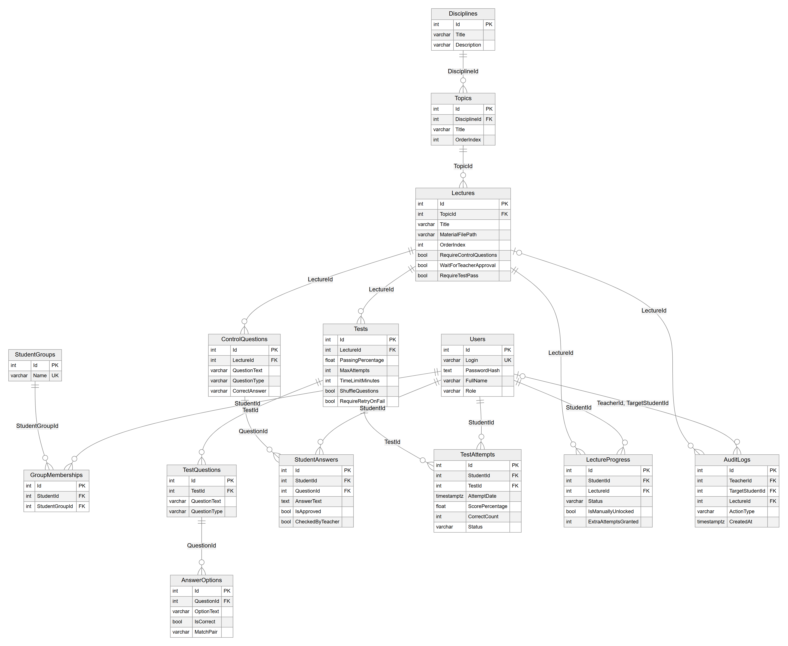
*Рисунок 1 — ER-диаграмма схемы базы данных studyroom_db (14 таблиц и 17 внешних ключей)*


### 4.3. Криптографическая защита паролей пользователей

В строгом соответствии с разделом 5 ТЗ хранение паролей пользователей в открытом виде полностью исключено. При регистрации студента (/Account/Register), создании пользователя преподавателем (/Teacher/Users) и первичной инициализации БД (DbSeeder.cs) используется штатный криптографический сервис ASP.NET Core Identity PasswordHasher<User> (алгоритм PBKDF2 с HMAC-SHA512, 128-битной случайной солью и 100 000 итераций). В столбце PasswordHash таблицы Users сохраняются только криптографические хеши вида AQAAAAIAAYagAAAAE..., что подтверждено прямыми SQL-проверками к СУБД PostgreSQL.


## 5. Описание реализованных функций и архитектуры приложения


### 5.1. Структура проекта StudyRoom

Приложение построено по модульной многослойной архитектуре в рамках проекта ASP.NET Core 10.0 Razor Pages:

- **Каталог Models/ — **содержит 14 классов доменных сущностей EF Core (User, StudentGroup, GroupMembership, Discipline, Topic, Lecture, ControlQuestion, Test, TestQuestion, AnswerOption, StudentAnswer, TestAttempt, LectureProgress, AuditLog) и перечисления в файле Enums.cs (UserRole, QuestionType, LectureStatus, TestAttemptStatus).
- **Каталог Data/ — **содержит контекст базы данных AppDbContext.cs с конфигурацией Fluent API и сервис начального наполнения БД DbSeeder.cs.
- **Каталог Services/ — **содержит ядро бизнес-логики: сервис контроля последовательного освоения лекций и проверки заданий LearningProgressService.cs, сервис защищённого хранения и генерации файлов MaterialStorageService.cs, а также расширения авторизации AuthExtensions.cs.
- **Каталог Pages/Account/ — **страницы аутентификации и безопасности: Login, Register, Logout и AccessDenied (возвращает HTTP 403 Forbidden).
- **Каталог Pages/Teacher/ — **административная панель преподавателя (защищена политикой TeacherOnly): Index (дашборд и AuditLogs), Disciplines (управление курсами, темами и лекциями), LectureEdit (загрузка файлов, конструктор 6 типов вопросов и тестов), Reviews (проверка развёрнутых ответов), Reports (сводная ведомость по группе, ручное открытие лекций и добавление попыток), Users (управление пользователями и группами).
- **Каталог Pages/Student/ — **учебный контур студента: Index (личный кабинет со сводкой результатов), Discipline (структура тем и лекций со статусами блокировки), Lecture (изучение теории, встроенный просмотр PDF и выполнение контрольных вопросов), Test (прохождение теста с таймером).
- **Каталог App_Data/Materials/ — **защищённое серверное файловое хранилище учебных материалов вне публичной директории wwwroot.
- **Каталог scripts/ — **автоматизированные сценарии эксплуатации и проверки: backup.ps1, restore.ps1, verify_12_scenarios.ps1.


### 5.2. Реализация основных сервисов бизнес-логики

Сервис LearningProgressService (файл Services/LearningProgressService.cs) инкапсулирует всю логику последовательного прохождения курса:

- **GetOrderedDisciplineLecturesAsync(disciplineId) — **формирует сквозную упорядоченную последовательность лекций дисциплины по возрастанию Topic.OrderIndex и Lecture.OrderIndex.
- **SynchronizeAndGetDisciplineProgressAsync(studentId, disciplineId) — **пересчитывает статусы всех лекций студента (Open, InProgress, WaitingTeacherReview, Completed, Locked) с учётом флага ручного открытия IsManuallyUnlocked и вычисляет общий процент освоения дисциплины.
- **CheckStudentAccessToLectureAsync(studentId, lectureId) — **выполняет строгую серверную проверку: разрешён ли студенту доступ к запрашиваемой лекции, и при блокировке формирует точное сообщение с указанием предыдущей незавершённой лекции.
- **CheckControlQuestionAnswer и CheckTestQuestionAnswer — **реализуют нормализацию строк (приведение к нижнему регистру, учёт букв «е/ё», разбор списков и пар соответствия) для автоматической проверки 5 типов вопросов и переводят 6-й тип (ExtendedText) в режим ожидания проверки преподавателем.


### 5.3. Защищённая потоковая отдача файлов учебных материалов

Файлы лекций (PDF, DOCX) не размещаются в папке wwwroot, поэтому к ним невозможно обратиться напрямую в обход бизнес-логики. В файле Program.cs зарегистрирован защищённый серверный маршрут /Materials/{mode}/{lectureId:int}, который проверяет аутентификацию пользователя, вызывает CheckStudentAccessToLectureAsync для студентов и только при наличии доступа открывает поток FileStream из каталога App_Data/Materials, отдавая документ либо для встроенного просмотра в браузере (Content-Disposition: inline), либо для скачивания (Download).

*Листинг 1 — Защищённый серверный обработчик просмотра и скачивания файлов лекций (Program.cs)*
```csharp
app.MapGet("/Materials/{mode}/{lectureId:int}", async (
    string mode, int lectureId, HttpContext httpContext,
    AppDbContext db, LearningProgressService progressService,
    MaterialStorageService storageService) =>
{
    if (httpContext.User.Identity?.IsAuthenticated != true)
        return Results.Challenge();

    var lecture = await db.Lectures.FirstOrDefaultAsync(l => l.Id == lectureId);
    if (lecture == null || string.IsNullOrWhiteSpace(lecture.MaterialFilePath))
        return Results.NotFound("Учебный материал для данной лекции не найден.");

    if (!httpContext.User.IsTeacher())
    {
        var studentId = httpContext.User.GetUserId();
        var access = await progressService.CheckStudentAccessToLectureAsync(studentId, lectureId);
        if (!access.Allowed)
            return Results.Redirect($"/Account/AccessDenied?Reason={Uri.EscapeDataString(access.DenialReason ?? "Доступ запрещён.")}");
    }

    var fullPath = storageService.GetFullFilePath(lecture.MaterialFilePath);
    if (fullPath == null)
        return Results.NotFound("Файл материала отсутствует в хранилище сервера.");

    var downloadName = lecture.MaterialOriginalFileName ?? Path.GetFileName(fullPath);
    var contentType = storageService.GetContentType(downloadName);
    var fileStream = new FileStream(fullPath, FileMode.Open, FileAccess.Read, FileShare.Read);

    if (string.Equals(mode, "Download", StringComparison.OrdinalIgnoreCase))
        return Results.File(fileStream, contentType, fileDownloadName: downloadName);

    httpContext.Response.Headers.Append("Content-Disposition", $"inline; filename=\"{Uri.EscapeDataString(downloadName)}\"");
    return Results.File(fileStream, contentType);
}).RequireAuthorization();
```


## 6. Скриншоты интерфейса преподавателя и студента

Ниже представлены 12 реальных скриншотов работающего веб-приложения StudyRoom, снятых в разрешении 1440×900 при прохождении демонстрационных сценариев под учётными записями преподавателя (teacher) и студентов группы ИСП-41 (student1 и student2).


### 6.1. Главная страница и вход в систему (/ и /Account/Login)

На экране отображается стартовая страница информационного ресурса со сводкой учебных показателей (количество дисциплин, лекций, тестов и зарегистрированных студентов), описанием ключевых возможностей системы и карточкой курса «Внедрение и поддержка компьютерных систем», а также форма аутентификации пользователя с защитой CSRF-токеном и памяткой демонстрационных аккаунтов.

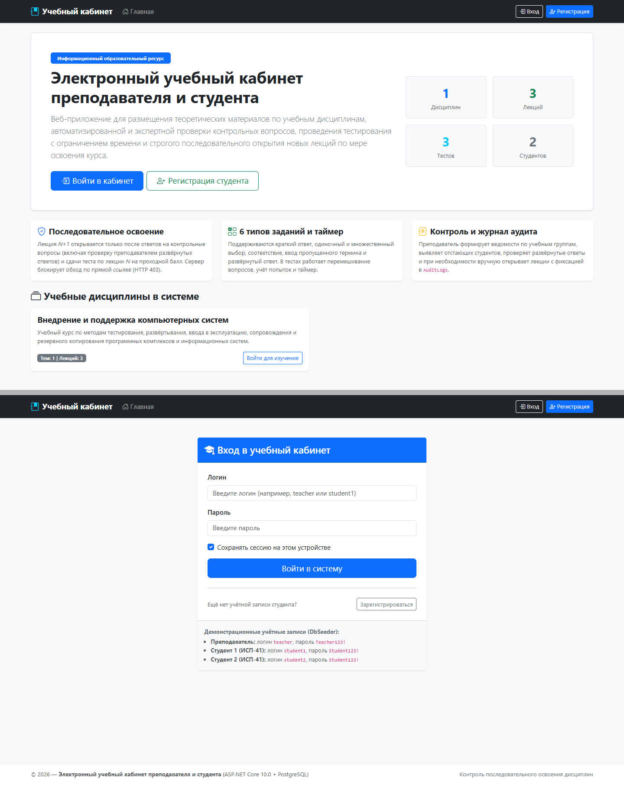
*Рисунок 2 — Главная страница информационного ресурса (/) и страница входа в учётную запись (/Account/Login)*


### 6.2. Панель управления преподавателя (/Teacher/Index)

Дашборд преподавателя Соколова А. В. отображает оперативную статистику учебного процесса (1 дисциплина, 1 тема, 3 лекции, 2 студента в 2 группах), карточку развёрнутого ответа студента Иванова И. С., ожидающего экспертной проверки по Лекции 2, и таблицу журнала аудита AuditLogs, где зафиксированы события первичной инициализации и предоставления дополнительных попыток тестирования.

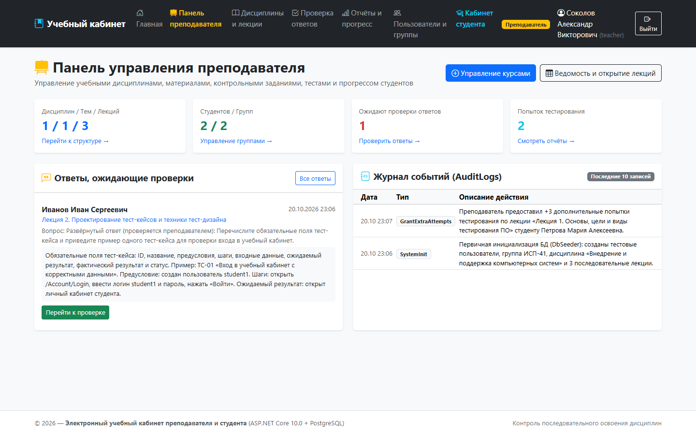
*Рисунок 3 — Панель управления преподавателя (/Teacher/Index) со сводкой, очередью ответов на проверку и журналом событий AuditLogs*


### 6.3. Управление дисциплинами, темами и лекциями (/Teacher/Disciplines)

Раздел позволяет преподавателю создавать и редактировать дисциплины, добавлять темы с указанием порядкового номера и формировать последовательность лекций. Для каждой лекции наглядно видны прикреплённый файл материала (PDF или DOCX), количество контрольных вопросов, параметры теста (порог 70%, 5 попыток) и активные условия открытия следующей лекции.

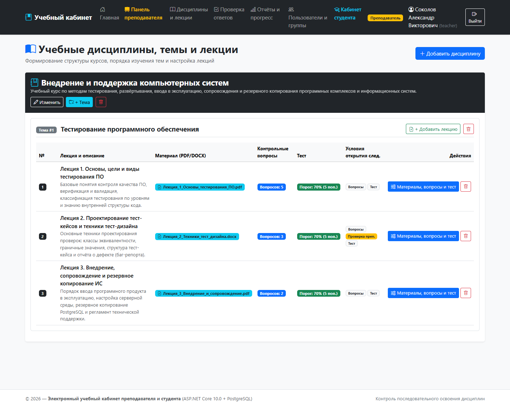
*Рисунок 4 — Управление учебными дисциплинами, темами и порядком лекций (/Teacher/Disciplines)*


### 6.4. Конструктор лекции, контрольных вопросов и теста (/Teacher/LectureEdit?id=1)

Единая рабочая страница настройки лекции объединяет три функциональных блока: (1) редактирование названия, порядкового номера, HTML-конспекта, загрузка/замена файла PDF/DOCX и флаги условий открытия следующей лекции; (2) конструктор контрольных вопросов всех 6 поддерживаемых типов с эталонными ответами; (3) настройка параметров итогового теста (проходной процент, максимум попыток, таймер в минутах, перемешивание вопросов) и список тестовых заданий.

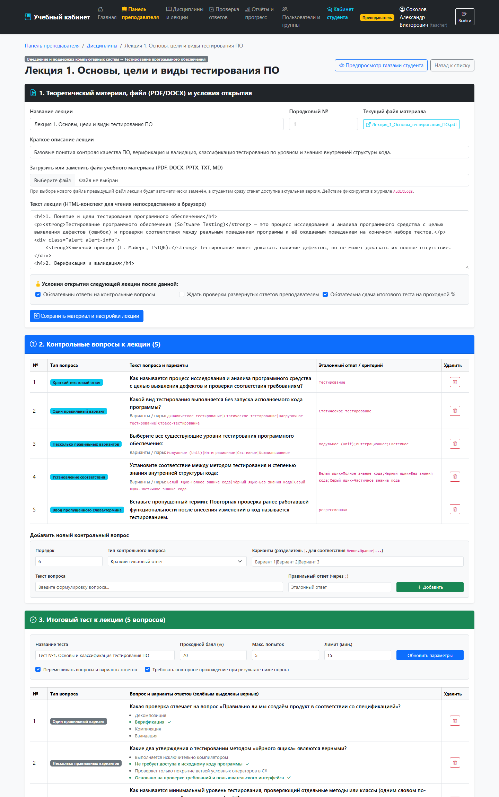
*Рисунок 5 — Страница редактирования лекции (/Teacher/LectureEdit?id=1): загрузка/замена файлов PDF/DOCX, условия открытия, конструктор 6 типов вопросов и настройка теста*


### 6.5. Проверка развёрнутых ответов студентов (/Teacher/Reviews)

В разделе отображаются ответы студентов на вопросы типа «Развёрнутый ответ (проверка преподавателем)». Преподаватель видит формулировку задания, критерии эталонного ответа, полный текст ответа студента Иванова И. С. по Лекции 2, поле для комментария и кнопки «Зачесть ответ» и «Отклонить (на доработку)».

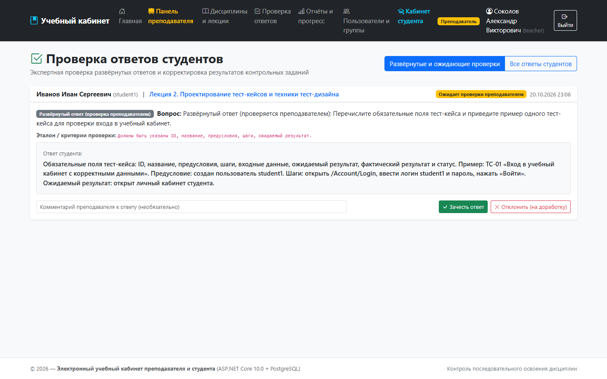
*Рисунок 6 — Страница экспертной проверки преподавателем развёрнутых ответов студентов (/Teacher/Reviews)*


### 6.6. Сводные отчёты по группе, выявление отстающих и управление доступом (/Teacher/Reports)

Ведомость по дисциплине «Внедрение и поддержка компьютерных систем» и группе ИСП-41 включает: (1) таблицу успеваемости студентов с процентом освоения курса, средним баллом, числом попыток и индикатором «Не завершил тему» для отстающих студентов; (2) матрицу управления доступом к лекциям с кнопками «Открыть вручную» и «+3 поп.» (видна метка «Ручной доступ» у студентки Петровой М. А.); (3) детальный журнал всех попыток прохождения тестов.

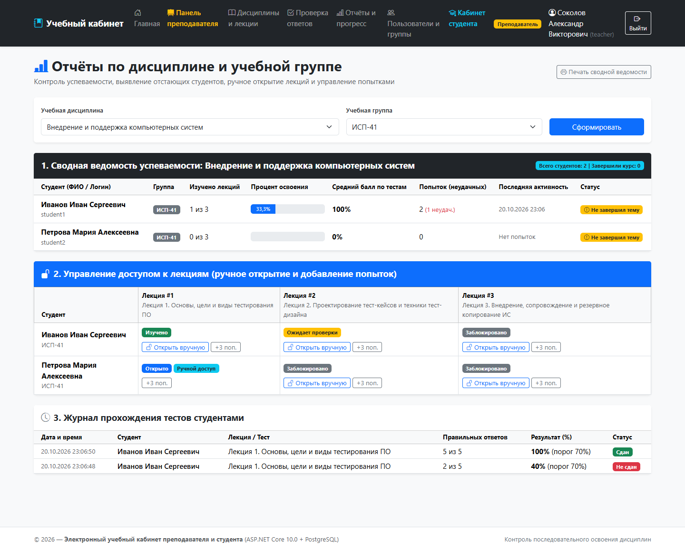
*Рисунок 7 — Сводная ведомость по дисциплине и группе ИСП-41 (/Teacher/Reports), выявление отстающих студентов, кнопки ручного открытия лекции и добавления попыток*


### 6.7. Управление пользователями и учебными группами (/Teacher/Users)

Страница позволяет преподавателю создавать новые учётные записи студентов и преподавателей с автоматическим хешированием пароля, формировать учебные группы (ИСП-41, ИСП-42), переводить студентов между группами и контролировать отсутствие паролей в открытом виде (в столбце хеша отображаются префиксы криптографических хешей AQAAAAIAAYagAAAAE...).

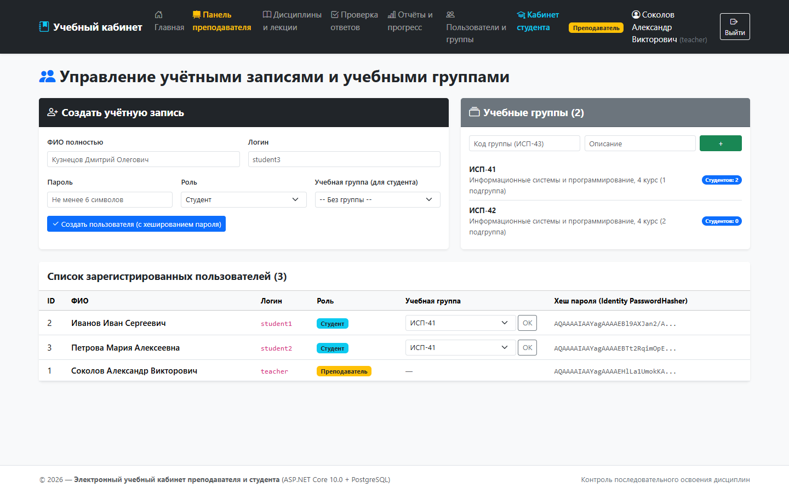
*Рисунок 8 — Управление учётными записями пользователей и учебными группами (/Teacher/Users)*


### 6.8. Личный кабинет студента (/Student/Index)

В личном кабинете студента Иванова И. С. (группа ИСП-41) отображается карточка изучаемой дисциплины с прогресс-баром освоения (33,3% — изучена 1 из 3 лекций), таблица «Мои результаты тестирования» (видно неудачную попытку 40% со статусом «Не сдан» и успешную пересдачу 100% со статусом «Сдан») и полный список ответов на контрольные вопросы со статусами «Зачтено» и «На проверке у преподавателя».

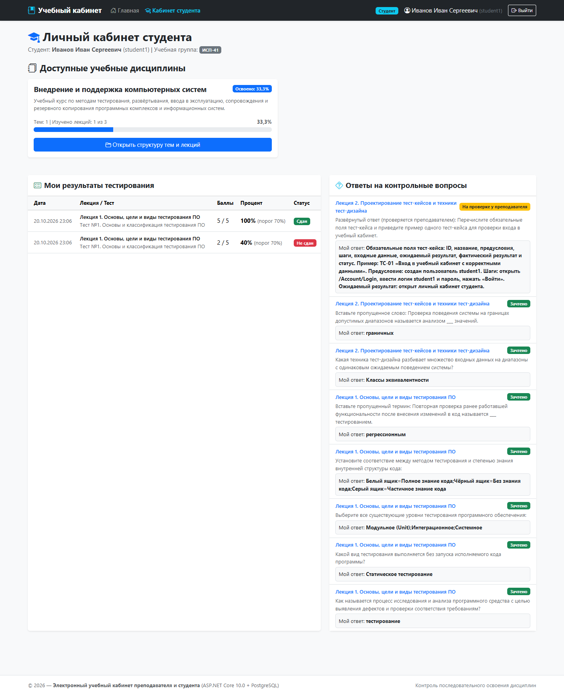
*Рисунок 9 — Личный кабинет студента student1 (/Student/Index) с процентом освоения дисциплины (33,3%), историей попыток тестирования и результатами контрольных вопросов*


### 6.9. Структура дисциплины и индикация статусов лекций (/Student/Discipline?id=1)

Экран наглядно демонстрирует работу механизма последовательного открытия лекций: Лекция 1 имеет зелёный статус «Изучено» (зачтено 5/5 вопросов, лучший балл теста 100%), благодаря чему Лекция 2 автоматически перешла в синий статус «Открыто» и доступна кнопка «Изучить лекцию». При этом Лекция 3 находится в сером статусе «Заблокировано» с пояснением «Завершите предыдущую лекцию».

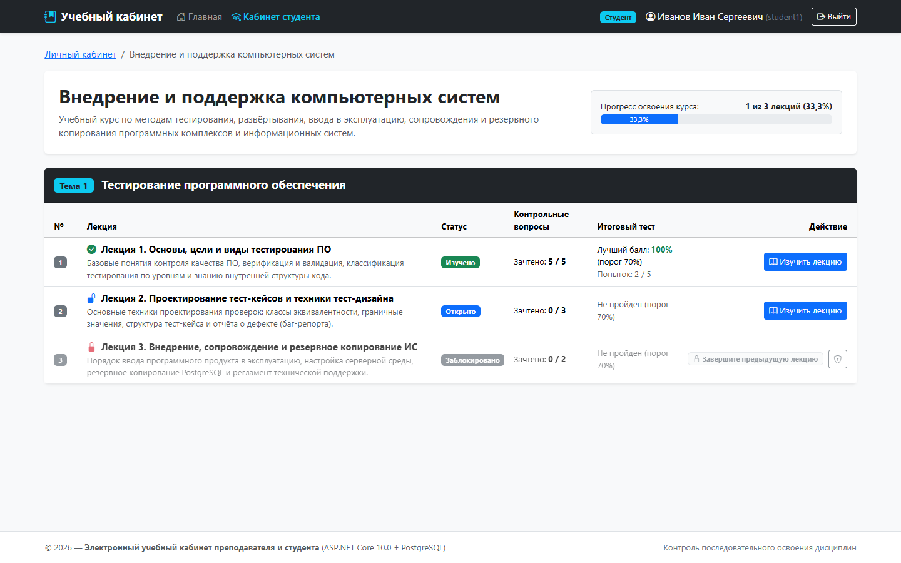
*Рисунок 10 — Структура дисциплины у студента student1 (/Student/Discipline?id=1): Лекция 1 изучена, Лекция 2 открыта, Лекция 3 заблокирована*


### 6.10. Изучение теоретического материала и выполнение контрольных вопросов (/Student/Lecture?id=1)

Страница открытой лекции содержит структурированный теоретический конспект, кнопки «Открыть документ в браузере» и «Скачать файл» для защищённого PDF-документа, а также интерактивную форму выполнения контрольных вопросов (краткий текстовый ответ, одиночный выбор, множественный выбор, установление соответствия через выпадающие списки и ввод пропущенного термина).

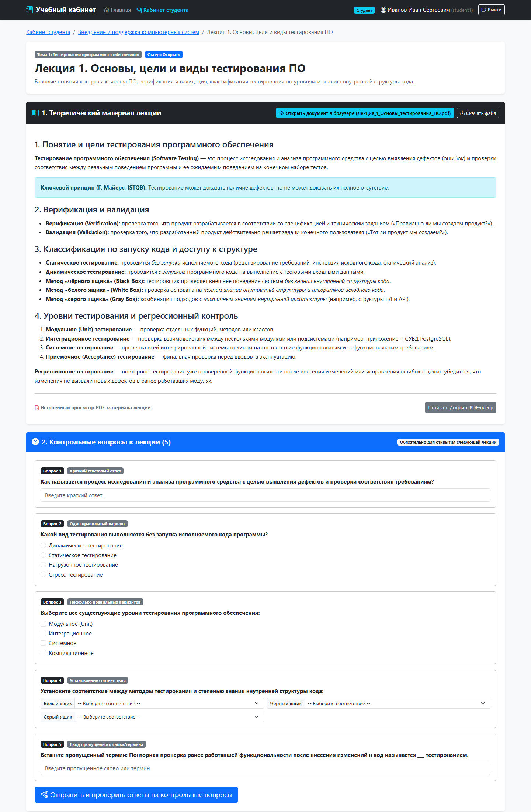
*Рисунок 11 — Страница изучения открытой лекции (/Student/Lecture?id=1) с теоретическим материалом, кнопками просмотра/скачивания PDF и формой контрольных вопросов 5 типов*


### 6.11. Прохождение итогового теста с таймером обратного отсчёта (/Student/Test?lectureId=2)

Во время тестирования в правом верхнем углу работает интерактивный таймер обратного отсчёта (14:58 из 15 минут), отображаются проходной порог (70%), номер текущей попытки (1 из 5) и статус перемешивания вопросов. После выбора ответов студент отправляет форму на сервер для автоматического расчёта результата.

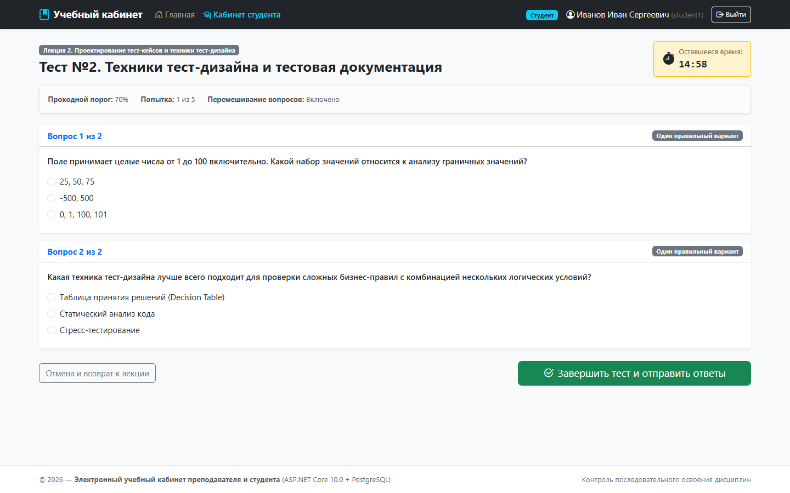
*Рисунок 12 — Страница прохождения итогового тестирования (/Student/Test?lectureId=2) с таймером обратного отсчёта и перемешиванием вопросов*


### 6.12. Серверная блокировка прямого перехода к закрытой лекции (HTTP 403 Forbidden)

При попытке студентки Петровой М. А. (student2), не сдавшей Лекцию 1, вручную ввести в адресную строку прямой URL /Student/Lecture?id=2 сервер отклоняет запрос с кодом HTTP 403 Forbidden и выводит точное объяснение причины отказа: для получения доступа к Лекции 2 необходимо сначала выполнить контрольные задания и сдать итоговый тест по предыдущей Лекции 1.

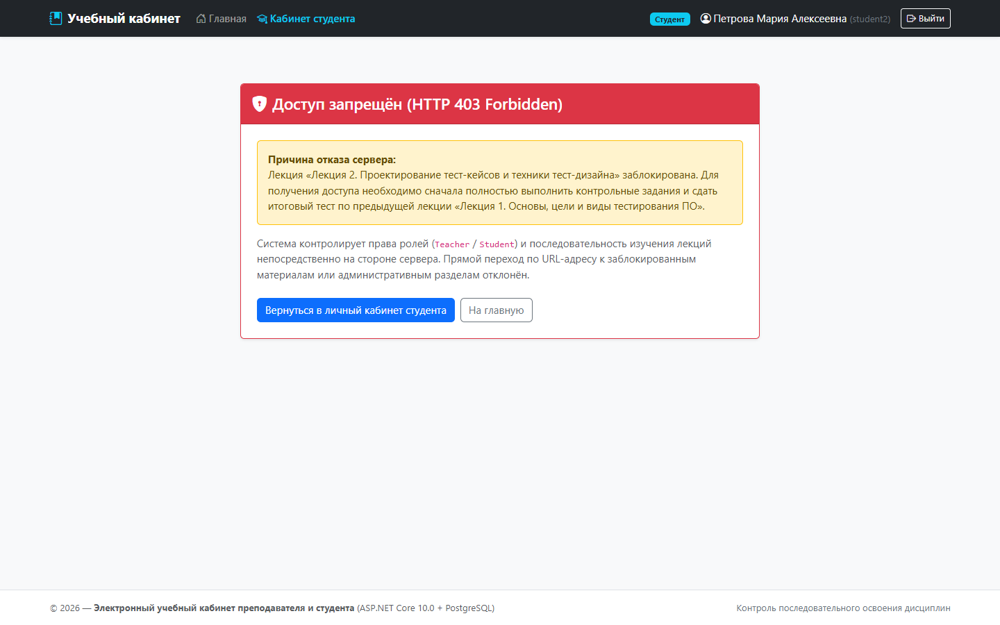
*Рисунок 13 — Экран серверной блокировки доступа (HTTP 403 Forbidden, /Account/AccessDenied) при попытке студентки student2 открыть закрытую Лекцию 2 по прямой ссылке*


## 7. Примеры загруженных лекций, контрольных вопросов и тестов

При первом запуске приложения инициализатор DbSeeder (файл Data/DbSeeder.cs) автоматически создаёт демонстрационную дисциплину «Внедрение и поддержка компьютерных систем», тему №1 «Тестирование программного обеспечения», генерирует в защищённом хранилище App_Data/Materials реальные файлы лекций в форматах PDF и DOCX и наполняет базу данных 3 последовательными лекциями, 10 контрольными вопросами всех 6 типов и 3 итоговыми тестами.


### 7.1. Загруженные лекции и условия открытия следующего материала

**Таблица 4 — Перечень демонстрационных лекций темы «Тестирование программного обеспечения»**

| № п/п | Название лекции | Файл материала в App_Data/Materials | Обязательны вопросы | Ждать проверки преподавателем | Обязателен тест (порог) |
| --- | --- | --- | --- | --- | --- |
| 1 | Лекция 1. Основы, цели и виды тестирования ПО | Лекция_1_Основы_тестирования_ПО.pdf (PDF) | Да (5 вопросов) | Нет (автопроверка) | Да (Тест №1, порог 70%) |
| 2 | Лекция 2. Проектирование тест-кейсов и техники тест-дизайна | Лекция_2_Техники_тест_дизайна.docx (DOCX) | Да (3 вопроса, вкл. развёрнутый) | Да (блокирует Лекцию 3 до одобрения) | Да (Тест №2, порог 70%) |
| 3 | Лекция 3. Внедрение, сопровождение и резервное копирование ИС | Лекция_3_Внедрение_и_сопровождение.pdf (PDF) | Да (2 вопроса) | Нет (автопроверка) | Да (Тест №3, порог 70%) |


### 7.2. Примеры контрольных вопросов всех 6 типов

**Таблица 5 — Контрольные вопросы к лекциям №1–№3 (все 6 типов из раздела 3.4 ТЗ)**

| Лекция | № | Тип вопроса (QuestionType) | Формулировка вопроса и варианты | Эталонный ответ / способ проверки |
| --- | --- | --- | --- | --- |
| Лекция 1 | 1 | ShortText (Краткий текстовый ответ) | Как называется процесс исследования и анализа программного средства с целью выявления дефектов и проверки соответствия требованиям? | тестирование (автопроверка) |
| Лекция 1 | 2 | SingleChoice (Один правильный вариант) | Какой вид тестирования выполняется без запуска исполняемого кода программы? (Динамическое \| Статическое \| Нагрузочное \| Стресс-тестирование) | Статическое тестирование (автопроверка) |
| Лекция 1 | 3 | MultipleChoice (Несколько правильных вариантов) | Выберите все существующие уровни тестирования ПО: (Модульное (Unit) \| Интеграционное \| Системное \| Компиляционное) | Модульное (Unit);Интеграционное;Системное (автопроверка) |
| Лекция 1 | 4 | Matching (Установление соответствия) | Установите соответствие между методом тестирования и степенью знания внутренней структуры кода: | Белый ящик=Полное знание кода; Чёрный ящик=Без знания кода; Серый ящик=Частичное знание кода |
| Лекция 1 | 5 | FillInBlank (Ввод пропущенного слова/термина) | Повторная проверка ранее работавшей функциональности после внесения изменений в код называется ___ тестированием. | регрессионным (автопроверка) |
| Лекция 2 | 1 | SingleChoice (Один правильный вариант) | Какая техника тест-дизайна разбивает множество входных данных на диапазоны с одинаковым ожидаемым поведением системы? | Классы эквивалентности (автопроверка) |
| Лекция 2 | 2 | FillInBlank (Ввод пропущенного слова/термина) | Проверка поведения системы на границах допустимых диапазонов называется анализом ___ значений. | граничных (автопроверка) |
| Лекция 2 | 3 | ExtendedText (Развёрнутый ответ) | Перечислите обязательные поля тест-кейса и приведите пример одного тест-кейса для проверки входа в учебный кабинет. | Ручная проверка преподавателем в /Teacher/Reviews (критерий: ID, название, предусловия, шаги, ожидаемый результат) |
| Лекция 3 | 1 | ShortText (Краткий текстовый ответ) | Какая штатная утилита PostgreSQL используется для создания логической резервной копии базы данных? | pg_dump (автопроверка) |
| Лекция 3 | 2 | SingleChoice (Один правильный вариант) | В какой конфигурации необходимо собирать приложение ASP.NET Core перед развёртыванием на компьютере преподавателя? | Release (автопроверка) |


### 7.3. Параметры и вопросы итоговых тестов

**Таблица 6 — Настройки и состав итоговых тестов к лекциям №1–№3**

| Тест | Параметры теста | Вопросы и типы заданий в тесте | Правильные ответы |
| --- | --- | --- | --- |
| Тест №1 (к Лекции 1) | Порог: 70%, Попыток: 5, Таймер: 15 мин., Перемешивание: Да, Пересдача при неудаче: Да | 5 вопросов: 1) SingleChoice (верификация/валидация); 2) MultipleChoice (метод «чёрного ящика»); 3) ShortText (минимальный уровень тестирования); 4) Matching (уровни тестирования и их назначение); 5) FillInBlank (тестирование без запуска кода) | 1) Верификация; 2) Не требует доступа к исходному коду + Основано на проверке требований; 3) модульное / unit; 4) Модульное, Интеграционное, Приёмочное; 5) статическим / статическое |
| Тест №2 (к Лекции 2) | Порог: 70%, Попыток: 5, Таймер: 15 мин., Перемешивание: Да, Пересдача при неудаче: Да | 2 вопроса: 1) SingleChoice (граничные значения для диапазона 1..100); 2) SingleChoice (техника тест-дизайна для комбинации логических условий) | 1) 0, 1, 100, 101; 2) Таблица принятия решений (Decision Table) |
| Тест №3 (к Лекции 3) | Порог: 70%, Попыток: 5, Таймер: 15 мин., Перемешивание: Да, Пересдача при неудаче: Да | 2 вопроса: 1) SingleChoice (HTTP-код при обращении к закрытой лекции); 2) MultipleChoice (состав резервной копии системы) | 1) 403 Forbidden (Отказ в доступе на стороне сервера); 2) Резервная копия БД PostgreSQL + Резервная копия каталога материалов |


## 8. Результаты проверки последовательного открытия лекций


### 8.1. Девятишаговый алгоритм последовательного открытия лекций

Алгоритм контроля последовательного изучения материалов реализован в строгом соответствии с разделом 3.6 технического задания и включает 9 последовательных шагов:

- **Шаг 1. Авторизация студента: **студент входит в систему (/Account/Login), получает защищённую Cookie StudyRoom.Auth с ролью Student.
- **Шаг 2. Открытие дисциплины: **студент выбирает дисциплину в личном кабинете (/Student/Discipline?id=1).
- **Шаг 3. Доступ к первой лекции: **сервер синхронизирует прогресс (SynchronizeAndGetDisciplineProgressAsync) — первая лекция всегда имеет статус Open, а лекции 2 и 3 — статус Locked.
- **Шаг 4. Изучение теории: **студент изучает HTML-конспект и PDF/DOCX-файл открытой лекции.
- **Шаг 5. Ответы на контрольные вопросы: **студент отправляет ответы на контрольные вопросы. Вопросы с автопроверкой оцениваются мгновенно; развёрнутый ответ переводит лекцию в статус WaitingTeacherReview.
- **Шаг 6. Прохождение тестирования: **студент сдаёт итоговый тест в пределах лимита времени и числа попыток.
- **Шаг 7. Серверная проверка выполнения всех условий: **метод EvaluateLectureCompletion проверяет, что все контрольные вопросы зачтены (IsApproved == true), развёрнутый ответ одобрен преподавателем (CheckedByTeacher == true) и имеется успешная попытка теста со ScorePercentage >= PassingPercentage.
- **Шаг 8. Автоматическое открытие следующей лекции: **при выполнении всех условий текущая лекция переходит в статус Completed, а следующая по порядку лекция автоматически получает статус Open.
- **Шаг 9. Повторное прохождение или ручное управление: **при результате ниже порога следующая лекция остаётся закрытой (Locked), а студент может пересдать тест в пределах доступных попыток либо обратиться к преподавателю за дополнительными попытками (+3 поп.) или ручным открытием.

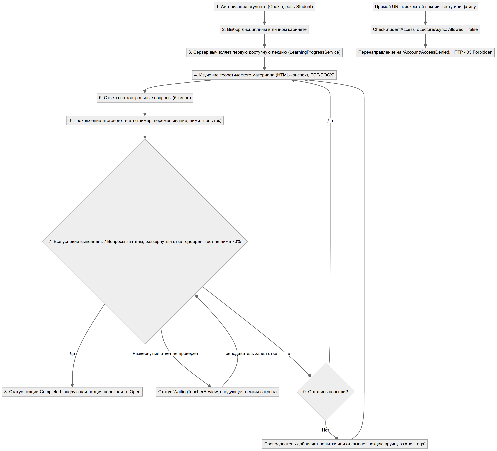
*Рисунок 14 — Блок-схема алгоритма последовательного открытия лекций и серверной блокировки прямых ссылок*


### 8.2. Серверный код проверки доступа и вычисления завершения лекции

*Листинг 2 — Серверный метод проверки условий завершения лекции (Services/LearningProgressService.cs)*
```csharp
private static (bool isCompleted, bool isWaitingReview, bool hasAnyActivity) EvaluateLectureCompletion(
    Lecture lecture, List<StudentAnswer> answers, List<TestAttempt> attempts)
{
    bool hasAnyActivity = answers.Any() || attempts.Any();
    bool questionsSatisfied = true;
    bool waitingTeacherReview = false;

    if (lecture.RequireControlQuestions && lecture.ControlQuestions.Any())
    {
        foreach (var q in lecture.ControlQuestions)
        {
            var ans = answers.FirstOrDefault(a => a.QuestionId == q.Id);
            if (ans == null) { questionsSatisfied = false; continue; }

            if (q.QuestionType == QuestionType.ExtendedText && lecture.WaitForTeacherApproval)
            {
                if (!ans.CheckedByTeacher || ans.IsApproved == null)
                {
                    waitingTeacherReview = true;
                    questionsSatisfied = false;
                }
                else if (ans.IsApproved == false) questionsSatisfied = false;
            }
            else if (ans.IsApproved != true) questionsSatisfied = false;
        }
    }

    bool testsSatisfied = true;
    if (lecture.RequireTestPass && lecture.Tests.Any())
    {
        foreach (var test in lecture.Tests)
        {
            bool passedThisTest = attempts.Any(a =>
                a.TestId == test.Id &&
                a.Status == TestAttemptStatus.Passed &&
                a.ScorePercentage >= test.PassingPercentage);
            if (!passedThisTest) testsSatisfied = false;
        }
    }

    bool isCompleted = questionsSatisfied && testsSatisfied;
    return (isCompleted, !isCompleted && waitingTeacherReview, hasAnyActivity);
}
```


### 8.3. Подтверждение результатов проверки на реальных сценариях

- **Блокировка прямого перехода по URL (HTTP 403 Forbidden): **при обращении студента к закрытой лекции (/Student/Lecture?id=2), её тесту (/Student/Test?lectureId=2) или файлу материала (/Materials/View/2, /Materials/Download/2) сервер возвращает код 403 Forbidden (проиллюстрировано на рисунке 13 — скриншот 12_student2_forbidden.png).
- **Автоматическое открытие Лекции 2 после сдачи Лекции 1 на 100%: **после зачёта 5 контрольных вопросов и сдачи Теста №1 с результатом 100% (>= 70%) статус Лекции 1 автоматически изменился на «Изучено», а Лекция 2 перешла в статус «Открыто» при сохранении блокировки Лекции 3 (проиллюстрировано на рисунке 10 — скриншот 09_student1_discipline.png).
- **Блокировка Лекции 3 до проверки преподавателем развёрнутого ответа: **после отправки студентом развёрнутого ответа по Лекции 2 лекция переходит в статус «Ожидает проверки» (WaitingTeacherReview), и даже при сданном Тесте №2 Лекция 3 остаётся закрытой до тех пор, пока преподаватель не нажмёт «Зачесть ответ» на странице /Teacher/Reviews (рисунок 6 — скриншот 05_teacher_reviews.png).
- **Ручное открытие лекции и добавление попыток с записью в AuditLogs: **на странице /Teacher/Reports (рисунок 7 — скриншот 06_teacher_reports.png) преподаватель может принудительно открыть любую лекцию отдельному студенту (ManualUnlock) или добавить +3 попытки (GrantExtraAttempts), что немедленно фиксируется в таблице AuditLogs (рисунок 3 — скриншот 02_teacher_dashboard.png).


## 9. Описание процесса внедрения на компьютер преподавателя


### 9.1. Подготовка аппаратно-программной среды и СУБД PostgreSQL (п. 6.1 ТЗ)

- **Операционная система: **Windows 10 / 11 (x64) или Windows Server 2019/2022, ОЗУ от 4 ГБ (рекомендуется 8 ГБ), не менее 2 ГБ свободного дискового пространства.
- **Среда выполнения .NET: **установлен пакет .NET 10.0 SDK / ASP.NET Core Runtime 10.0 (проверка: dotnet --version -> 10.0.301).
- **Сервер базы данных: **установлена СУБД PostgreSQL 18, служба postgresql-x64-18 запущена и слушает локальный порт TCP 5432.
- **Конфигурация подключения и хранилища: **в файле appsettings.json задана строка подключения DefaultConnection к базе studyroom_db и путь к защищённому каталогу материалов App_Data/Materials.

*Листинг 3 — Конфигурация подключения к СУБД PostgreSQL и каталога материалов (appsettings.json)*
```json
{
  "ConnectionStrings": {
    "DefaultConnection": "Host=localhost;Port=5432;Database=studyroom_db;Username=postgres;Password=postgres;"
  },
  "MaterialsStorage": {
    "DirectoryPath": "App_Data/Materials"
  }
}
```


### 9.2. Сборка и публикация приложения в конфигурации Release (п. 6.2 ТЗ)

В ходе выполнения этапа внедрения выполнена сборка и публикация релизной версии приложения в директорию ./publish без единого предупреждения или ошибки компиляции:

*Листинг 4 — Команды публикации Release-сборки и запуска веб-сервера Kestrel*
```powershell
dotnet build -c Release
dotnet publish -c Release -o .\publish
dotnet .\publish\StudyRoom.dll --urls "http://0.0.0.0:5050" 
```

При первом старте опубликованного приложения автоматически выполняются миграции EF Core (context.Database.MigrateAsync()), создаётся каталог App_Data/Materials и инициализируются учётная запись преподавателя, демонстрационные дисциплины и материалы (DbSeeder).


### 9.3. Организация доступа студентов: два варианта эксплуатации (п. 6.3 ТЗ)

- **Вариант 1. Локальная работа на компьютере преподавателя: **приложение запускается на рабочем ПК преподавателя и открывается через браузер по адресу http://localhost:5050 (или http://localhost:5254). Этот режим используется для подготовки лекций, демонстрации материалов на проекторе и индивидуального тестирования студентов за компьютером преподавателя.
- **Вариант 2. Работа по локальной вычислительной сети (ЛВС) учебного класса: **веб-приложение и СУБД PostgreSQL размещаются на компьютере преподавателя (например, с IPv4-адресом 192.168.1.100). В брандмауэре Windows открывается входящий TCP-порт веб-сервера Kestrel (5050), тогда как порт СУБД PostgreSQL (5432) остаётся строго закрытым для внешних сетевых подключений (слушает только 127.0.0.1). Студенты подключаются со своих рабочих станций через браузер по адресу http://192.168.1.100:5050, не имея прямого сетевого доступа ни к базе данных, ни к файловой системе сервера.

*Листинг 5 — Настройка правила брандмауэра Windows для доступа студентов из локальной сети*
```powershell
New-NetFirewallRule -DisplayName "StudyRoom Web App (TCP 5050)" `
    -Direction Inbound -LocalPort 5050 -Protocol TCP -Action Allow
```


## 10. План и результаты комплексного тестирования


### 10.1. Методика автоматизированного E2E и интеграционного тестирования

Для всесторонней проверки приложения перед вводом в эксплуатацию разработан автоматизированный тестовый скрипт scripts/verify_12_scenarios.ps1, выполняющий реальные HTTP-запросы (GET, POST, multipart/form-data) с поддержкой Cookie-сессий (StudyRoom.Auth), извлечением Antiforgery-токенов (__RequestVerificationToken) и прямыми проверочными SQL-запросами к системным каталогам и таблицам СУБД PostgreSQL 18.


### 10.2. Результаты выполнения 12 обязательных проверок (Раздел 7 ТЗ)

**Таблица 7 — Результаты тестирования по 12 обязательным сценариям раздела 7 технического задания**

| № | Проверка по ТЗ | Входные данные и действия | Ожидаемый результат | Фактический результат | Статус |
| --- | --- | --- | --- | --- | --- |
| 1 | Авторизация преподавателя | POST /Account/Login (teacher / Teacher123!) | Открывается панель преподавателя | HTTP 200 OK (/Teacher/Index), роль Teacher подтверждена | ПРОЙДЕНО |
| 2 | Авторизация студента | POST /Account/Login (student1 / Student123!) | Открывается личный кабинет студента | HTTP 200 OK (/Student/Index), роль Student подтверждена | ПРОЙДЕНО |
| 3 | Попытка открыть следующую лекцию без теста | GET /Student/Lecture?id=2 до сдачи Теста №1 | Доступ запрещён | HTTP 403 Forbidden (/Account/AccessDenied) | ПРОЙДЕНО |
| 4 | Прохождение теста с результатом ниже порога | POST /Student/Test?lectureId=1 с неверными ответами (0% и 40% < 70%) | Следующая лекция остаётся закрытой | Попытка записана со статусом Failed, Лекция 2 возвращает HTTP 403 Forbidden | ПРОЙДЕНО |
| 5 | Прохождение теста с требуемым результатом | POST /Student/Test?lectureId=1 с верными ответами (100% >= 70%) | Следующая лекция становится доступной при выполнении остальных условий | Статус Лекции 1 — Completed, Лекция 2 автоматически открыта (HTTP 200 OK) | ПРОЙДЕНО |
| 6 | Повторный вход в систему | Выход (/Account/Logout) и повторный вход студента student1 | Прогресс студента сохраняется | В БД и ЛК сохранён прогресс освоения, все ответы и попытки тестирования | ПРОЙДЕНО |
| 7 | Попытка студента открыть панель преподавателя | GET и POST запросы от student1 ко всем 6 страницам /Teacher/... | Доступ запрещён | Все маршруты /Teacher/* строго возвращают HTTP 403 Forbidden | ПРОЙДЕНО |
| 8 | Замена учебного материала | POST /Teacher/LectureEdit?id=1&handler=UpdateLecture с новым PDF-файлом | Студенту доступна актуальная версия | Файл обновлён в App_Data/Materials, студент скачивает новую версию (HTTP 200 OK), запись в AuditLogs | ПРОЙДЕНО |
| 9 | Одновременная работа нескольких студентов | Параллельные независимые Cookie-сессии student1 и student2 | Система корректно обрабатывает запросы | Сессии и индивидуальный прогресс студентов полностью изолированы | ПРОЙДЕНО |
| 10 | Перезапуск приложения | Остановка процесса Kestrel, повторный запуск и проверка прогресса | Приложение запускается, сохранённые данные доступны | После перезапуска сервера прогресс 66,7% и история попыток полностью сохранены | ПРОЙДЕНО |
| 11 | Резервное копирование и восстановление | Запуск scripts/backup.ps1 и восстановление через scripts/restore.ps1 | Данные могут быть восстановлены из проверенной копии | Дамп studyroom_db.sql и архив Materials.zip успешно созданы и без ошибок развёрнуты | ПРОЙДЕНО |
| 12 | Попытка доступа к закрытой лекции по прямой ссылке | Прямые запросы к /Student/Lecture?id=3, /Student/Test?lectureId=3 и /Materials/View/3 | Сервер отклоняет неразрешённый запрос | Сервер отклоняет все прямые запросы к странице, тесту и файлу с кодом HTTP 403 Forbidden | ПРОЙДЕНО |


### 10.3. Сводка 6-блочного глубокого аудита и E2E-тестирования

**Таблица 8 — Результаты расширенного 6-блочного E2E-аудита (scripts/verify_12_scenarios.ps1)**

| Блок проверки | Объём и содержание автоматизированных проверок | Результат |
| --- | --- | --- |
| Блок 1. БД, безопасность и матрица ролей | Проверка 14 таблиц, 15 PK и 17 FK в PostgreSQL; регистрация нового студента; проверка хешей AQAAAA...; проверка 0 уязвимостей NuGet; проверка HTTP 403 на всех /Teacher/* для студента | PASSED |
| Блок 2. Все 6 типов контрольных вопросов | Автоматическая проверка ShortText, SingleChoice, MultipleChoice, Matching, FillInBlank; экспертная проверка ExtendedText преподавателем с разблокировкой Лекции 3 | PASSED |
| Блок 3. Тестирование и лимит попыток | Настройка параметров теста; сдача ниже порога (<70%); блокировка при исчерпании попыток; добавление +3 попыток преподавателем; успешная сдача (100%) | PASSED |
| Блок 4. Защита прямых URL и файлов PDF/DOCX | Отклонение GET/POST к закрытым лекциям, тестам и маршрутам /Materials/View/{id}, /Materials/Download/{id} (HTTP 403); замена файла преподавателем | PASSED |
| Блок 5. Панель преподавателя, отчёты и ЛК | Полный цикл CRUD дисциплин, тем, лекций, вопросов и пользователей; сводная ведомость по группе ИСП-41; ручное открытие лекции (ManualUnlock) и проверка AuditLogs | PASSED |
| Блок 6. Вёрстка Sticky Footer, рестарт, бэкап и Release | Обход всех 13 страниц (HTTP 200 OK), проверка Flexbox-каркаса (d-flex flex-column min-vh-100, mt-auto), перезапуск сервера, цикл backup.ps1/restore.ps1 и dotnet publish -c Release | PASSED |


### 10.4. Журнал обнаруженных при тестировании дефектов и их устранения

В соответствии с разделом 7 ТЗ все выявленные в ходе ревизии и тестирования замечания были задокументированы, исправлены в исходном коде и повторно проверены регрессионным прогоном автотестов (релизы v1.0.1 и v1.0.2).

**Таблица 9 — Дефекты и замечания, выявленные и устранённые в ходе тестирования (релизы v1.0.1 – v1.0.2)**

| № | Описание выявленного дефекта / замечания | Затронутые файлы | Выполненное исправление и результат повторной проверки |
| --- | --- | --- | --- |
| 1 | Предупреждения безопасности NU1902/NU1903 для транзитивного пакета System.Security.Cryptography.Pkcs 9.0.0 (GHSA-2fmv-rv2c-59x7, GHSA-846f-f764-76mx) | StudyRoom.csproj | Явно подключён пропатченный пакет System.Security.Cryptography.Pkcs версии 10.0.13. Команда dotnet list package --vulnerable --include-transitive подтвердила 0 уязвимостей (v1.0.1). |
| 2 | Некорректное позиционирование подвала (footer): свойство position: absolute; bottom: 0 приводило к наложению футера поверх контента при прокрутке длинных таблиц | Pages/Shared/_Layout.cshtml, _Layout.cshtml.css, wwwroot/css/site.css | Удалено абсолютное позиционирование; внедрён Sticky Footer Flexbox-каркас (d-flex flex-column min-vh-100 на body, flex-grow-1 pb-5 на main и mt-auto py-3 на footer). Футер всегда расположен строго внизу страницы (v1.0.1). |
| 3 | Вызов Results.File(fullPath, contentType) в Minimal API интерпретировал строковый путь как виртуальный путь внутри wwwroot и возвращал 404 для файлов в App_Data/Materials | Program.cs | Переделано на потоковую передачу через new FileStream(fullPath, FileMode.Open, FileAccess.Read, FileShare.Read). Просмотр и скачивание PDF/DOCX работают со статусом 200 OK (v1.0.2). |
| 4 | При следовании за 302-редиректом после POST multipart/form-data некоторые HTTP-клиенты сохраняли заголовок Content-Type: multipart/form-data в GET-запросе к /Teacher/LectureEdit?id=1 | Pages/Teacher/LectureEdit.cshtml.cs | В OnGetAsync добавлен резервный разбор параметра id из строки запроса (Request.Query["id"]), исключающий ошибку привязки пустого тела (v1.0.2). |
| 5 | Страница отказа в доступе (/Account/AccessDenied) устанавливала код 403 только для GET-запросов и не имела обработчика OnPost, а также требовались дополнительные обработчики редактирования тем и сброса пароля | Pages/Account/AccessDenied.cshtml.cs, Pages/Teacher/Disciplines.cshtml.cs, Pages/Teacher/Users.cshtml.cs | Добавлен метод OnPost() со статусом Status403Forbidden в AccessDeniedModel, обработчик OnPostUpdateTopicAsync в DisciplinesModel и обработчики OnPostResetPasswordAsync / OnPostDeleteUserAsync в UsersModel (v1.0.2). |
| 6 | При восстановлении дампа БД поверх существующей схемы через restore.ps1 выводились предупреждения о существующих таблицах | scripts/backup.ps1 | В вызов pg_dump.exe добавлены флаги --clean --if-exists, обеспечивающие чистое идемпотентное пересоздание таблиц при восстановлении (v1.0.2). |


## 11. Инструкция пользователя


### 11.1. Тестовые и демонстрационные учётные записи

**Таблица 10 — Учётные записи для входа в систему (создаются автоматически DbSeeder)**

| Роль в системе | Логин | Пароль | ФИО пользователя | Учебная группа | Стартовая страница после входа |
| --- | --- | --- | --- | --- | --- |
| Преподаватель (Teacher) | teacher | Teacher123! | Соколов Александр Викторович | — | /Teacher/Index (Панель преподавателя) |
| Студент 1 (Student) | student1 | Student123! | Иванов Иван Сергеевич | ИСП-41 | /Student/Index (Личный кабинет студента) |
| Студент 2 (Student) | student2 | Student123! | Петрова Мария Алексеевна | ИСП-41 | /Student/Index (Личный кабинет студента) |


### 11.2. Пошаговое руководство для преподавателя

- **Шаг 1. Вход в систему: **откройте страницу /Account/Login, введите логин teacher и пароль Teacher123! и нажмите «Войти в систему».
- **Шаг 2. Управление дисциплинами, темами и лекциями (/Teacher/Disciplines): **для создания нового курса нажмите «+ Добавить дисциплину». В карточке дисциплины нажмите «+ Тема» для создания раздела, а внутри темы — «+ Добавить лекцию», указав порядковый номер.
- **Шаг 3. Загрузка материалов, вопросов и настройка теста (/Teacher/LectureEdit): **нажмите кнопку «Материалы, вопросы и тест» напротив лекции. В блоке №1 прикрепите или замените файл PDF/DOCX и отметьте условия открытия следующей лекции. В блоке №2 добавьте контрольные вопросы любого из 6 типов. В блоке №3 задайте проходной процент (70%), число попыток, лимит времени в минутах и тестовые вопросы.
- **Шаг 4. Проверка развёрнутых ответов (/Teacher/Reviews): **перейдите на вкладку «Проверка ответов», ознакомьтесь с ответом студента, введите комментарий и нажмите «Зачесть ответ» (после чего студенту автоматически откроется следующая лекция при условии сданного теста) либо «Отклонить (на доработку)».
- **Шаг 5. Контроль успеваемости и ручное управление доступом (/Teacher/Reports): **выберите дисциплину и группу (ИСП-41). В сводной ведомости проверьте отстающих студентов (метка «Не завершил тему»). При необходимости нажмите «Открыть вручную» для разблокировки лекции или «+3 поп.» для предоставления дополнительных попыток.
- **Шаг 6. Управление пользователями и группами (/Teacher/Users): **создавайте новые учебные группы и учётные записи студентов, изменяйте привязку к группе или сбрасывайте пароль при обращении студента.


### 11.3. Пошаговое руководство для студента

- **Шаг 1. Регистрация или вход: **войдите на странице /Account/Login под выданной учётной записью (например, student1 / Student123!) либо зарегистрируйтесь через /Account/Register, выбрав свою учебную группу.
- **Шаг 2. Выбор дисциплины (/Student/Index и /Student/Discipline): **в личном кабинете нажмите «Открыть структуру тем и лекций». Первая лекция открыта для изучения («Открыто»), а последующие помечены статусом «Заблокировано».
- **Шаг 3. Изучение теории и ответы на контрольные вопросы (/Student/Lecture): **прочитайте конспект лекции, при необходимости откройте или скачайте документ PDF/DOCX. Заполните ответы на все контрольные вопросы в блоке №2 и нажмите «Отправить и проверить ответы на контрольные вопросы».
- **Шаг 4. Прохождение итогового теста (/Student/Test): **нажмите «Начать тестирование», ответьте на вопросы до истечения таймера обратного отсчёта и нажмите «Завершить тест и отправить ответы». При наборе не менее 70% и зачтённых контрольных вопросах следующая лекция откроется автоматически.


## 12. Регламент технического сопровождения и резервного копирования


### 12.1. График и периодичность регламентных работ

**Таблица 11 — Регламент профилактического обслуживания информационного ресурса StudyRoom**

| Вид регламентной работы | Периодичность | Ответственный | Используемый инструмент / действие |
| --- | --- | --- | --- |
| Контроль доступности веб-сервера Kestrel и службы PostgreSQL | Ежедневно перед началом занятий | Преподаватель / администратор | Проверка службы postgresql-x64-18 и открытие главной страницы / |
| Полное резервное копирование БД и файлов учебных материалов | Ежедневно после окончания занятий и перед каждым обновлением | Преподаватель / администратор | Скрипт scripts/backup.ps1 (создаёт studyroom_db.sql и Materials.zip) |
| Аудит прав доступа и журнала действий | Еженедельно | Ведущий преподаватель | Просмотр журнала AuditLogs в /Teacher/Index и списка пользователей в /Teacher/Users |
| Контрольное тестовое восстановление из резервной копии | 1 раз в семестр | Администратор учебного кабинета | Скрипт scripts/restore.ps1 на проверочном контуре |
| Установка обновлений, патчей безопасности и миграций БД | По мере выхода новых релизов | Разработчик / администратор | git pull origin master, dotnet publish -c Release, перезапуск приложения |


### 12.2. Автоматизированное резервное копирование и восстановление

В состав проекта включены два готовых PowerShell-скрипта (scripts/backup.ps1 и scripts/restore.ps1), обеспечивающих полное резервное копирование и аварийное восстановление как базы данных PostgreSQL (с флагами --clean --if-exists), так и серверного каталога загруженных материалов App_Data/Materials:

*Листинг 6 — Команды запуска резервного копирования и восстановления данных*
```powershell
# 1. Создание полной резервной копии (БД PostgreSQL + архив материалов лекций):
powershell -ExecutionPolicy Bypass -File .\scripts\backup.ps1

# 2. Восстановление базы данных и файлов материалов из выбранной резервной копии:
powershell -ExecutionPolicy Bypass -File .\scripts\restore.ps1 `
    -BackupFolderPath ".\Backups\backup_20261020_230853" 
```


### 12.3. Порядок установки обновлений и действия при нештатных ситуациях

- **Порядок обновления через Git и GitHub: **перед установкой обновления обязательно выполняется scripts/backup.ps1. Затем из репозитория https://github.com/Ivan091020/StudyRoom.git загружаются актуальные изменения (git pull origin master --tags), выполняется проверка безопасности пакетов (dotnet list package --vulnerable --include-transitive), сборка релизной версии (dotnet publish -c Release -o ./publish) и перезапуск веб-сервера Kestrel.
- **Действия при недоступности СУБД PostgreSQL (NpgsqlException): **проверить и запустить системную службу командой Start-Service postgresql-x64-18, убедиться в корректности строки подключения DefaultConnection в appsettings.json.
- **Действия при повреждении файла учебного материала или сбое БД: **восстановить актуальный файл лекции через интерфейс /Teacher/LectureEdit либо выполнить полное восстановление из последней ежедневной копии в каталоге Backups/ с помощью скрипта scripts/restore.ps1.


## 13. Заключение о выполненной работе

В ходе выполнения индивидуального практического задания №3 разработан с нуля, протестирован, внедрён в конфигурацию Release и обеспечен полным комплектом эксплуатационной документации информационный веб-ресурс «Электронный учебный кабинет преподавателя и студента» (StudyRoom) на базе платформы ASP.NET Core 10.0 (Razor Pages, C#) и СУБД PostgreSQL 18.

Все функциональные и архитектурные требования технического задания выполнены в полном объёме:

- спроектирована и развёрнута база данных studyroom_db из 14 таблиц (13 обязательных сущностей ТЗ + таблица AuditLogs) с 17 внешними ключами и криптографическим хешированием паролей PasswordHasher<User>;
- реализована ролевая модель безопасности (Teacher и Student) с серверной защитой всех административных страниц и учебных маршрутов (HTTP 403 Forbidden);
- реализована загрузка, замена и защищённая потоковая отдача учебных материалов (PDF, DOCX) из серверного хранилища App_Data/Materials;
- реализованы все 6 типов контрольных вопросов (включая экспертную проверку развёрнутых ответов преподавателем) и система тестирования с таймером обратного отсчёта, перемешиванием вопросов и контролем попыток;
- реализован и подтверждён автотестами железный серверный механизм последовательного открытия лекций, исключающий обход последовательности по прямым ссылкам;
- выполнено комплексное 6-блочное E2E-тестирование по всем 12 обязательным сценариям ТЗ, устранены все выявленные замечания и подготовлены скрипты резервного копирования и восстановления.

**Таблица 12 — Сводная таблица выполнения критериев оценивания индивидуального практического задания**

| № | Критерий оценивания по ТЗ | Максимальный балл | Фактическое выполнение в проекте StudyRoom | Оценка (балл) |
| --- | --- | --- | --- | --- |
| 1 | Реализация авторизации и разграничения прав | 10 | Cookie-аутентификация, PasswordHasher<User>, политики TeacherOnly и StudentOrTeacher, HTTP 403 Forbidden | 10 |
| 2 | Управление дисциплинами, темами и лекциями | 10 | Полный CRUD дисциплин, тем и упорядоченных лекций в /Teacher/Disciplines и /Teacher/LectureEdit | 10 |
| 3 | Загрузка и просмотр теоретических материалов | 10 | Загрузка и замена PDF/DOCX в App_Data/Materials, защищённый просмотр в браузере и скачивание | 10 |
| 4 | Реализация контрольных вопросов и тестов | 15 | Все 6 типов контрольных вопросов + ручная проверка преподавателем + тесты с таймером, порогом 70% и перемешиванием | 15 |
| 5 | Последовательное открытие лекций | 15 | Серверный контроль в LearningProgressService, блокировка прямых ссылок к страницам, тестам и файлам | 15 |
| 6 | Сохранение результатов и просмотр прогресса | 10 | Личный кабинет студента с процентом освоения курса и сводная ведомость преподавателя по группам + AuditLogs | 10 |
| 7 | Тестирование и устранение дефектов | 10 | Автотест scripts/verify_12_scenarios.ps1 (6 блоков, 12 сценариев ТЗ), устранение 6 дефектов в v1.0.1–v1.0.2 | 10 |
| 8 | Внедрение приложения на компьютер преподавателя | 10 | Публикация Release-сборки (./publish), настройка Kestrel, PostgreSQL 18 и локальной сети | 10 |
| 9 | Документация и регламент сопровождения | 10 | Полный отчёт (.docx и .md), руководство по внедрению, инструкция пользователя, регламент и скрипты backup/restore | 10 |
| — | ИТОГО | 100 | Все требования технического задания выполнены в полном объёме | 100 |
